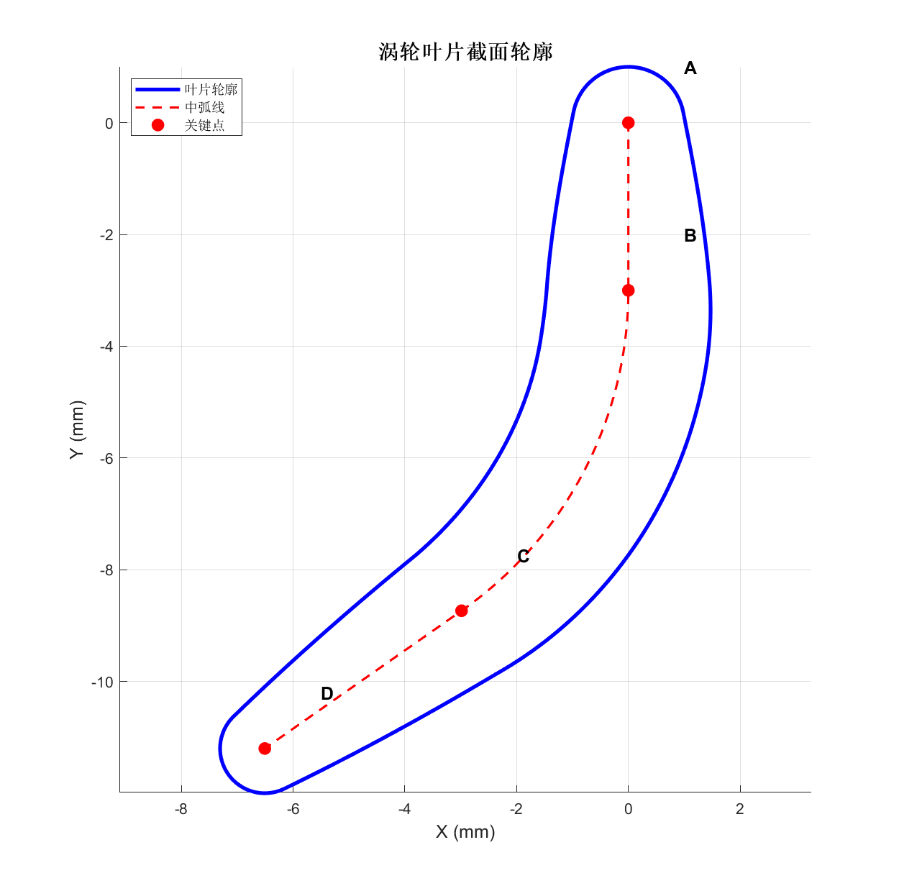

# MATLAB 涡轮叶片截面建模

用 MATLAB 生成参数化二维叶片型线，导出 XYZ 坐标，再在 SolidWorks 中建立叶片实体。适用于轴流式涡轮叶片的截面几何探索、课程设计和 CAD 建模练习。

程序以“进口直线 + 中间圆弧 + 出口直线”为中弧线，结合变半径圆族的包络线生成两侧轮廓，并用前、后缘圆弧连接。输出位于 XY 平面，Z 坐标均为 0，长度单位为 **mm**。

> 本仓库提供几何建模程序，不包含 CFD、有限元、电磁计算或发电功率预测；单个二维截面也不等同于完整的三维扭曲叶片。



## 快速开始

1. 下载仓库并解压，或使用 Git 克隆。
2. 在 MATLAB 中将当前文件夹切换到仓库根目录。
3. 运行：

```matlab
blade_profile
```

程序会显示轮廓、中弧线和 A/B/C/D 关键点，同时在 `output/` 中生成坐标与图像。主程序只使用基础 MATLAB 功能，不需要 Symbolic Math Toolbox。历史版本 `legacy/original_blade_profile.m` 使用 `syms/solve`，需要该工具箱。

也可以直接使用 [默认坐标示例](examples/blade_profile_xyz.txt)，按照 [SolidWorks 操作说明](docs/solidworks.md) 导入。

## 文件说明

| 文件 | 用途 |
| --- | --- |
| `blade_profile.m` | 整理后的主程序，参数修改与 CAD 导出入口 |
| `legacy/original_blade_profile.m` | 仅移除身份注释的原始脚本，便于比较 |
| `examples/*.txt` | 本次用 MATLAB 运行主程序生成的默认坐标 |
| `docs/solidworks.md` | 从坐标文件到 SolidWorks 实体的操作说明 |
| `docs/algorithm.md` | 原理、角度约定、数值限制与整理改动 |
| `tests/smoke_test.m` | 默认参数的几何连接与导出检查 |

## 参数怎么改

编辑主程序第 1、2 节。当前版本沿用原始 `.m` 文件的默认参数，不将其他历史草稿中的尺寸混用。

| 参数 | 默认值 | 含义 |
| --- | --- | --- |
| `r1` | 1 mm | 前缘圆半径 |
| `r2` | 0.8 mm | 后缘圆半径 |
| `rmax` | 1.5 mm | 圆族最大半径，不是全厚度 |
| `alfa` | 0° | 进口段相对负 Y 方向的角度 |
| `beta` | 55° | 出口段相对负 Y 方向的角度 |
| `R` | 7 mm | 中间圆弧半径 |
| `By` | −3 mm | 进口直线末端纵坐标；同步修改 `Bx = By*tan(alfa)` |
| `Dy` | −11.2 mm | 出口端纵坐标；同步修改 `Dx` 中对应的纵坐标 |
| `n_AB/n_BC/n_CD` | 100/200/100 | 中弧线各段采样点数 |
| `target_points` | 500 | 完整闭合轮廓的导出采样点数，含首尾闭合点 |

角度变量在代码中用弧度表示，例如 `beta = 55*pi/180`。当前几何分支针对向负 Y 方向延伸、向左弯曲的形状；调整时宜保持 `0 <= alfa < beta < 90°`、`Dy < Cy`、半径为正。代码不是任意参数组合的自动设计器。

## 原理概览

设中弧线为 $\mathbf c(s)$，$s$ 为弧长；单位切向、法向分别为 $\mathbf T$、$\mathbf N$，圆族半径为 $r(s)$。两侧包络的触点为：

$$
\mathbf p_\pm(s)=\mathbf c(s)+r(s)\left[-r'(s)\mathbf T(s)\pm\sqrt{1-r'(s)^2}\mathbf N(s)\right].
$$

当半径不变时，公式退化为沿法线两侧偏移；半径变化时还包含切向修正项。脚本用有限差分估算切线和半径变化率，以 PCHIP 插值控制半径分布，然后连接前后缘圆弧。推导与限制见 [算法说明](docs/algorithm.md)。

## 与 SolidWorks 的联系

```text
参数 → MATLAB 二维轮廓 → XYZ 文本 → SolidWorks 曲线
     → 平面草图（转换实体引用）→ 闭合检查 → 拉伸/后续建模
```

这里是**坐标文件交换**，没有调用 SolidWorks API，也不会自动创建零件或装配体。优先导入四段 TXT 曲线再在同一草图中连接，可避免整条闭合曲线在部分版本中的导入问题。具体步骤、单位检查和常见问题见 [SolidWorks 操作说明](docs/solidworks.md)。

## 输出

- `blade_profile_simple.xlsx`：带 X/Y/Z 表头，便于查看数据。
- `blade_profile_xyz.txt`：500 行三列、制表符分隔、无表头的闭合轮廓。
- `leading_edge.txt`、`pressure_side.txt`、`trailing_edge.txt`、`suction_side.txt`：四段独立开放曲线，保留各段端点。
- `blade_profile.png`：轮廓预览。

程序每次运行会覆盖 `output/` 中的同名文件；该目录不纳入版本管理。`pressure/suction` 延用原脚本的叶盆/叶背命名，实际压力侧与吸力侧仍取决于流向和工况。

## 验证与边界

运行 `run('tests/smoke_test.m')` 可检查默认参数下的有限坐标、段间端点一致性、轮廓闭合、500 点输出及文本读回一致性。当前发布版已在本机 MATLAB 中执行；详细环境和结果见 [验证记录](docs/validation.md)。

端点重合不代表曲率连续，也不保证 CAD 插值后没有自交。修改参数后需要重新检查型线、尺度和 CAD 草图。当前采样按点序号简化，不是等弧长重采样；最大半径的位置也按采样序号设置，不严格等于弦长或弧长的三分之一。

仓库只发布整理后的程序、说明和重新生成的坐标，不包含论文全文、原始操作日志及个人资料。尚未指定开源许可证，公开可见不等同于授予任意再分发授权。
